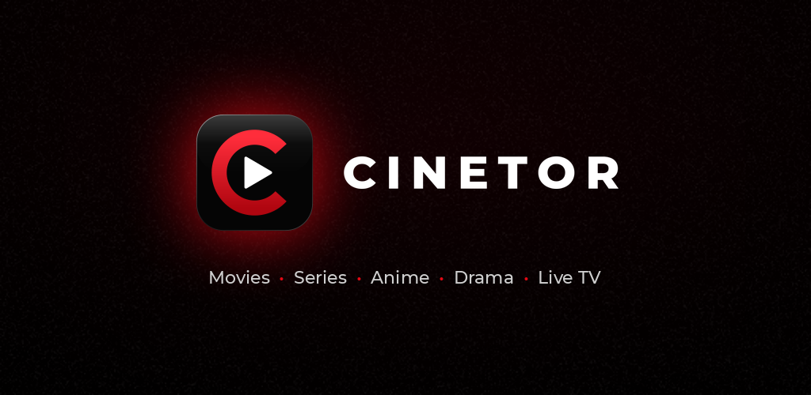
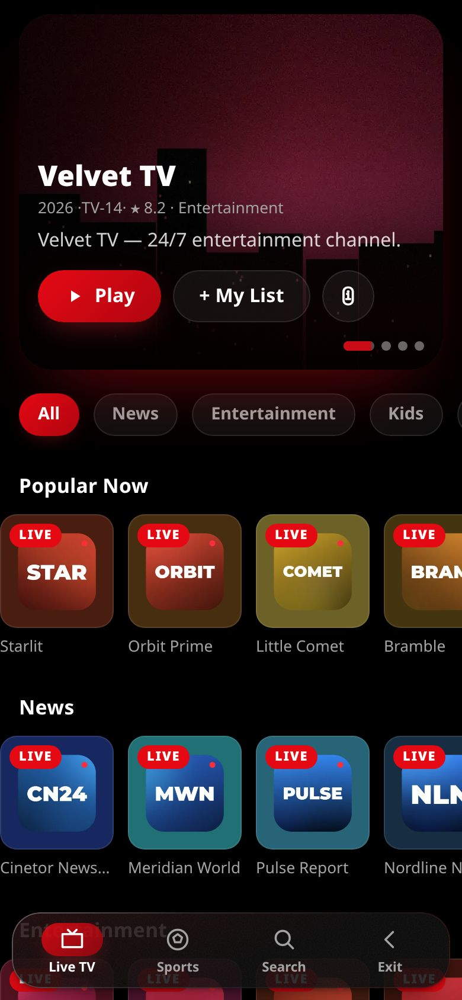
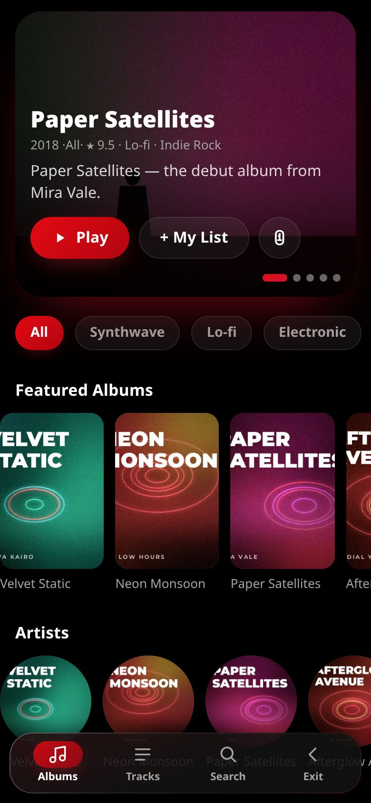
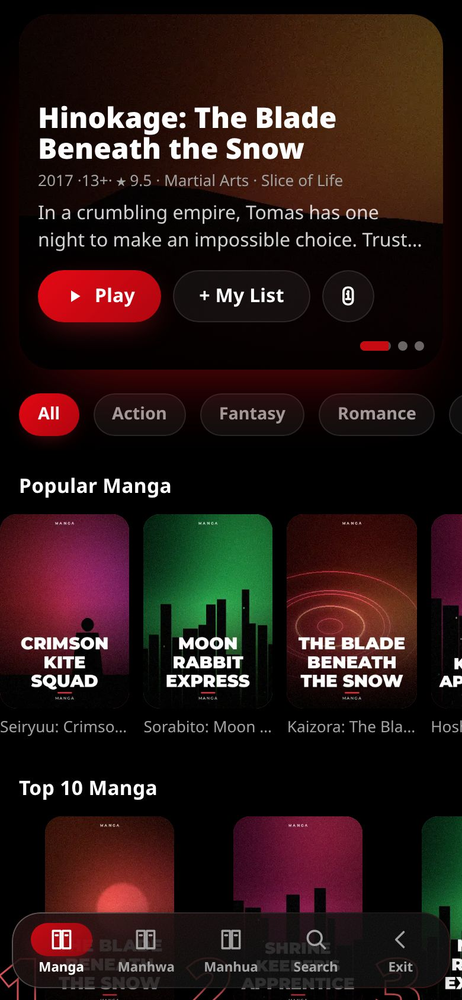
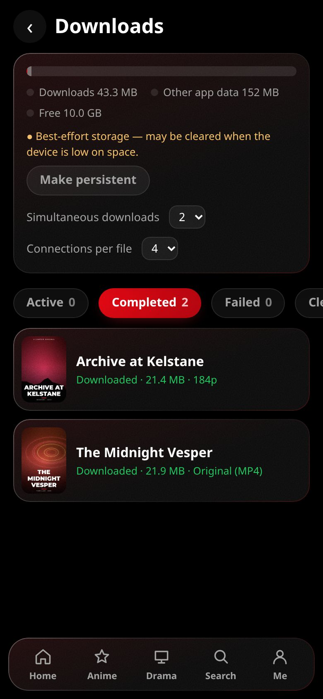
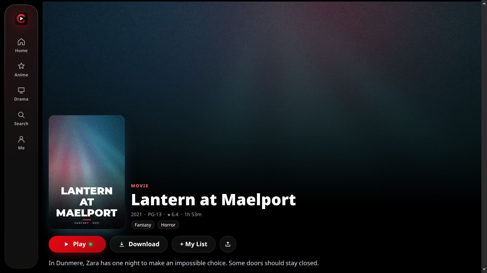

  

<h1 align="center">Cinetor</h1>

Movies · Series · Anime · Drama · Live TV · Sports · Music · Comics — one red/black glass app.

  <a href="https://github.com/Ashrix404/cinetor-app/releases/latest"><b>⬇ Download latest release</b></a> ·
  <a href="https://ashrix404.github.io/cinetor-app/"><b>🌐 Website</b></a> ·
  <a href="https://ashrix404.github.io/cinetor-app/app"><b>▶ Open Web App (PWA)</b></a>

## Downloads

| Platform | File (in [latest release](https://github.com/Ashrix404/cinetor-app/releases/latest)) |
|---|---|
| Android phone / tablet | `Cinetor-*-universal.apk` (or `arm64-v8a` / `armeabi-v7a` / `x86_64` for smaller size) |
| Android TV / Google TV / TV box / Fire TV | same APK (universal or `armeabi-v7a` for most TV boxes) |
| Windows 10/11 | `Cinetor_*_x64-setup.exe` or `.msi` |
| Linux | `Cinetor_*_amd64.deb` (Debian/Ubuntu) or `.AppImage` (any distro) |
| iPhone / iPad / any device | Web App → install as PWA (below) |

### Install the Web App (PWA)
- **Android (Chrome):** open the web app → menu ⋮ → *Install app*.
- **iPhone / iPad (Safari):** open the web app → Share → *Add to Home Screen*.
- **Desktop (Chrome/Edge):** install icon in the address bar.

### Android TV
Download the APK on the TV (e.g. *Downloader* app) or copy via USB → open → allow *Install unknown apps*. Cinetor appears in the TV launcher.

## Features
- Glassmorphism UI, animated splash, 3 themes (Noir · Obsidian · Ember), adaptive effects for low-end and high-end devices
- Auto-sliding hero banners, categories + genres in every section, UI color follows the thumbnail
- Skeleton shimmer while details load; video pre-buffers so Play starts instantly
- Player: quality, speed, audio tracks, subtitles (style + sync), hold for 2×, double-tap ±10 s, seek, brightness/volume gestures, portrait/landscape, in-app floating mini player, picture-in-picture, background audio
- Multi-connection downloader with full download details and offline playback
- Fast search with local history (Home, Anime, Drama); Live TV, Music, Comics and 18+ are isolated spaces
- Live TV guide (EPG), Sports, Music player, Manga/Manhwa/Manhua reader, PIN-locked 18+ section
- Profiles, settings, TV remote (D-pad) support

## Screenshots

  
  
  
  

## About
- **Developed By Mythbrix**
- Thanks to [Ahmed Ishtiaq Zarir](https://ahmedishtiaquezarir.pro.bd/)
- Telegram Channel: <https://t.me/mythbrix_vault> · Telegram Group: <https://t.me/cinetor>
- This product uses the TMDB API but is not endorsed or certified by TMDB.

> Current build uses mock/test video sources (no real content providers yet).
